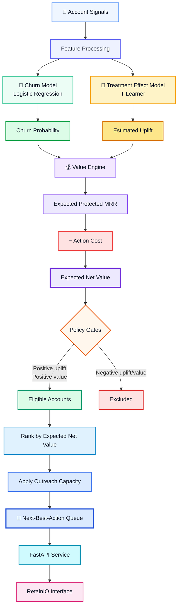
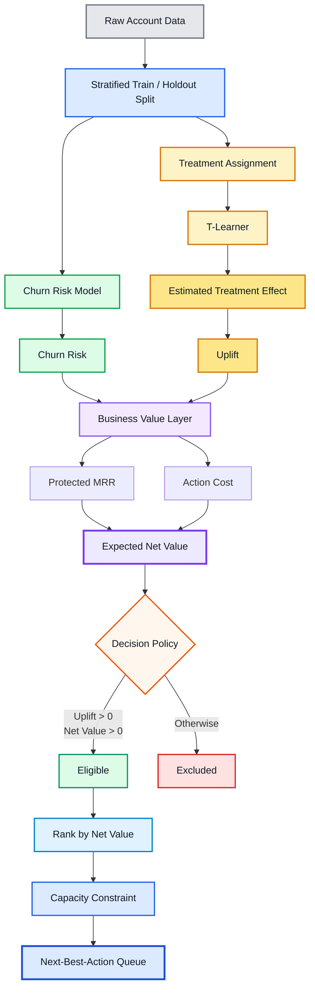
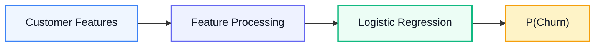
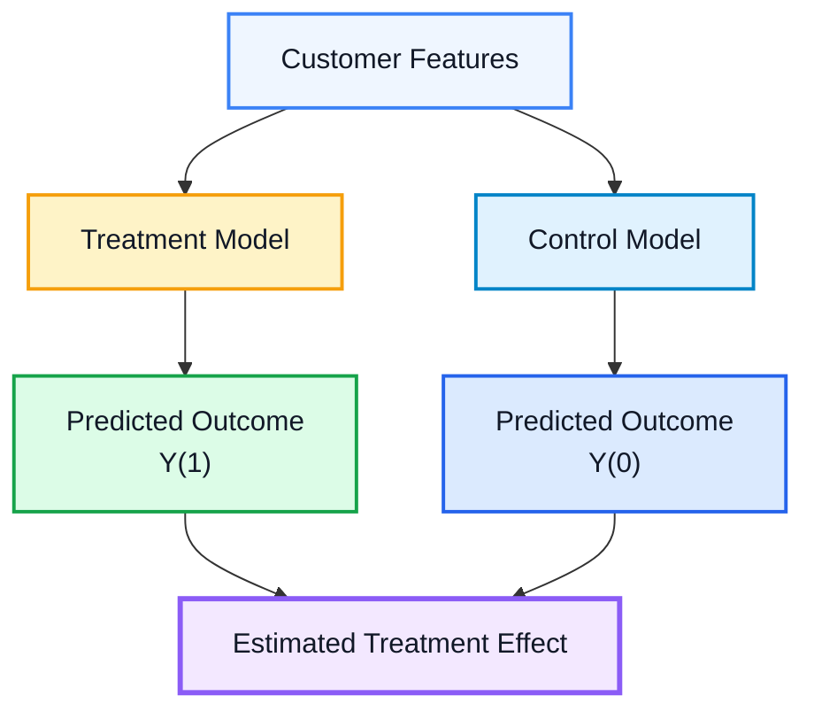
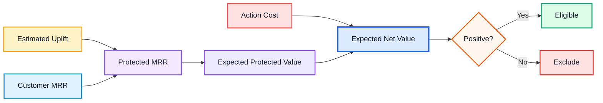

# RetainIQ — Value-Based Retention Decision Engine

> **Go beyond churn prediction. Prioritize retention interventions by expected incremental value.**

[](https://www.python.org/)
[](https://fastapi.tiangolo.com/)
[](https://www.docker.com/)
[](LICENSE)

**RetainIQ is a retention decisioning system that goes beyond conventional churn prediction.**

Instead of simply identifying customers who are likely to churn, RetainIQ estimates **which customers are likely to respond to a retention intervention**, combines treatment uplift with customer value and intervention cost, and produces a **capacity-constrained next-best-action queue**.

---

# 🎯 Business Problem

Traditional churn systems usually answer one question:

> **Who is likely to leave?**

But that is not necessarily the same as:

> **Who should the business actually contact?**

A customer with a high churn probability may:

* be unlikely to respond to an intervention;
* have relatively low customer value;
* cost more to retain than the value expected to be protected;
* consume limited outreach capacity that could be used more effectively elsewhere.

RetainIQ separates these decisions:

```text
Who may churn?
      ↓
Who can be influenced?
      ↓
What value could be protected?
      ↓
Where should limited retention effort be spent?
```

This turns a standard churn prediction problem into a **decisioning problem**.

---

# 🧠 Core Idea

RetainIQ keeps **prediction** and **decisioning** separate.

### 1. Churn Risk

A logistic classifier estimates:

> **Who is likely to churn?**

The output is a customer-level churn probability.

### 2. Treatment Effect

A T-learner estimates the difference between the expected outcome under treatment and control.

```text
Estimated Uplift
=
Expected outcome with intervention
−
Expected outcome without intervention
```

This answers:

> **Who is likely to be influenced by the intervention?**

### 3. Expected Protected Value

Positive uplift is converted into expected protected recurring revenue:

```text
Expected Protected MRR
=
max(Uplift, 0) × MRR
```

### 4. Expected Net Value

Intervention cost is incorporated:

```text
Expected Net Value
=
Expected Protected MRR
−
Action Cost
```

### 5. Capacity-Constrained Decisioning

The policy:

1. removes negative-uplift candidates;
2. removes negative-value candidates;
3. ranks eligible customers by expected net value;
4. applies the available outreach capacity.

The result is a **next-best-action queue**, rather than a simple churn leaderboard.

---

# 🏗️ System Architecture



---

# 🔄 End-to-End Decision Pipeline



---

# ⚖️ Risk-Only vs Value-Aware Targeting

RetainIQ intentionally includes a risk-only baseline so the decision policy can be compared with a conventional churn-targeting strategy.

### Risk-only

```text
Churn Probability
        ↓
Rank Customers
        ↓
Select Highest Risk
        ↓
Apply Capacity
```

### Value-aware

```text
Churn Risk
    +
Treatment Uplift
    +
Customer Value
    −
Action Cost
    ↓
Expected Net Value
    ↓
Remove Negative-Uplift / Negative-Value Candidates
    ↓
Rank Eligible Customers
    ↓
Apply Capacity
    ↓
Next-Best-Action Queue
```

The central distinction is:

> **The customer most likely to churn is not necessarily the customer for whom intervention creates the most value.**

---

# 📐 Decision Logic

| Layer                   | Question                         | Output                 |
| ----------------------- | -------------------------------- | ---------------------- |
| **Churn Model**         | Who may leave?                   | Churn probability      |
| **Treatment Model**     | Who may respond to intervention? | Estimated uplift       |
| **Value Layer**         | What value could be protected?   | Expected protected MRR |
| **Cost Layer**          | What does intervention cost?     | Action cost            |
| **Policy Engine**       | Should we intervene?             | Eligibility            |
| **Capacity Constraint** | Who should receive outreach?     | Ranked queue           |

This separation prevents churn probability from becoming the final business decision.

---

# 🖥️ Decision Intelligence Interface

The application exposes the decision process through account, policy and model-health views.

### Account-level analysis

Each scored account can expose:

* churn risk;
* treatment uplift;
* expected net value;
* reason codes;
* recommended action.

### Policy controls

The decision policy can be adjusted through:

* churn-risk threshold;
* outreach capacity.

The resulting targeting queue can then be inspected against the risk-only baseline.

### Model monitoring

The monitoring layer exposes:

* discrimination;
* calibration;
* segment quality;
* stability / drift metrics.

---

# 📊 Reproducibility

The default deterministic workflow uses:

| Property              | Configuration                 |
| --------------------- | ----------------------------- |
| Generated accounts    | **2,400**                     |
| Train / holdout split | **75 / 25**                   |
| Random seed           | **42**                        |
| Treatment assignment  | **Randomized**                |
| Holdout               | **Untouched during training** |
| Runtime artifacts     | Generated locally             |
| CI                    | Retrains from scratch         |

Runtime models, metrics, accounts and policies are generated into:

```text
data/runtime/
```

These runtime artifacts are intentionally not committed.

---

# 🧪 Real-World Randomized-Data Benchmark

RetainIQ includes a separate feasibility benchmark using the **64,000-row Hillstrom email experiment**.

The benchmark:

1. downloads the commit-pinned dataset;
2. validates its SHA-256 checksum;
3. validates the leakage-safe schema;
4. trains a treatment-effect model;
5. evaluates on a joint-stratified holdout;
6. applies a **20% outreach-capacity policy**;
7. produces JSON and Markdown evidence under `artifacts/real_data/`.

The targeting policy is evaluated using held-out evidence.

Promotion requires:

* held-out Qini;
* top-capacity uplift;
* IPW policy value.

A positive average treatment effect alone is **not sufficient** for promotion.

The target, split, reuse audit and promotion thresholds are frozen before the benchmark run in the real-data admission record.

---

# 🔬 Machine Learning Methodology

## Churn Prediction

RetainIQ uses a logistic classifier to estimate customer churn probability.



---

## Treatment Effect Estimation

RetainIQ uses a **T-learner** to estimate treatment effects.

Separate outcome models are fitted for treatment and control conditions:



Conceptually:

```text
Estimated Treatment Effect
=
Y(1) − Y(0)
```

where:

* `Y(1)` = predicted outcome under treatment;
* `Y(0)` = predicted outcome under control.

---

# 💰 Value-Based Decisioning

The treatment effect becomes useful when connected to the economics of the intervention.



This allows RetainIQ to prioritize interventions based on **expected incremental business value**, rather than churn probability alone.

---

# 🔌 API

RetainIQ exposes the decisioning workflow through a FastAPI service.

| Endpoint                 | Purpose                                                                      |
| ------------------------ | ---------------------------------------------------------------------------- |
| `GET /api/summary`       | Active policy, value-aware outcome, risk-only baseline and priority accounts |
| `GET /api/accounts`      | Scored holdout population                                                    |
| `GET /api/accounts/{id}` | Risk, uplift, net value, reasons and recommended play                        |
| `POST /api/score`        | Score a new account from current signals                                     |
| `GET /api/policy/curve`  | Compare value-aware and risk-only value across thresholds                    |
| `PUT /api/policy`        | Persist policy threshold and outreach capacity                               |
| `GET /api/monitoring`    | Held-out discrimination, calibration, segment and stability metrics          |

When running locally, interactive API documentation is available at:

```text
http://127.0.0.1:8000/docs
```

---

# 🏛️ Project Structure

```text
retain-iq/
│
├── signalroom/
│   ├── training.py
│   ├── real_benchmark.py
│   ├── main.py
│   └── ...
│
├── tests/
│   └── ...
│
├── docs/
│   ├── architecture.md
│   ├── model-card.md
│   └── REAL_DATA_ADMISSION.md
│
├── artifacts/
│   └── real_data/
│
├── .github/
├── .devcontainer/
├── Dockerfile
├── docker-compose.yml
├── pyproject.toml
├── render.yaml
├── app.js
└── README.md
```

> **Note:** The repository's Python package directory remains `signalroom/` unless you also rename the internal source package. Renaming the project branding to RetainIQ does not require changing the Python package name.

---

# 🐳 Run Locally

## Requirements

* Python **3.11+**
* Docker *(optional)*

## Python

Create a virtual environment:

```bash
python -m venv .venv
```

### Windows

```bash
.venv\Scripts\activate
```

### macOS / Linux

```bash
source .venv/bin/activate
```

Install development dependencies:

```bash
pip install -e ".[dev]"
```

Train the default workflow:

```bash
python -m signalroom.training
```

Start the API:

```bash
uvicorn signalroom.main:app --reload
```

Then open:

```text
http://127.0.0.1:8000
```

API documentation:

```text
http://127.0.0.1:8000/docs
```

---

## Docker

Run the application stack with:

```bash
docker compose up --build
```

---

# 🧪 Verification

The repository includes automated checks covering:

* deterministic data generation;
* randomized treatment assignment;
* value and capacity gates;
* risk-only comparison;
* account scoring;
* policy persistence;
* account detail;
* monitoring artifacts;
* API validation.

Run:

```bash
ruff check .
pytest --cov=signalroom --cov-fail-under=85
node --check app.js
docker compose config -q
```

---

# 🛡️ Engineering & Reproducibility

RetainIQ is designed as a reproducible ML application rather than a single notebook experiment.

Key engineering practices include:

* deterministic random seed;
* untouched holdout evaluation;
* treatment assignment controls;
* model card;
* reproducible training;
* Docker support;
* FastAPI serving;
* automated tests;
* linting;
* dependency management;
* CI retraining;
* checksum-pinned real-world benchmark;
* explicit promotion criteria.

---

# 💡 What RetainIQ Demonstrates

### Data Science

* Classification
* Treatment-effect estimation
* Uplift modeling
* Model calibration
* Policy evaluation
* Customer value modeling
* Holdout evaluation
* Experimentation concepts

### Decision Science

* Next-best-action decisioning
* Capacity-constrained targeting
* Value-based targeting
* Cost-aware intervention
* Risk vs incremental-impact analysis

### ML Engineering

* Python
* FastAPI
* Docker
* CI
* Automated testing
* Reproducible training
* API-based model serving
* Monitoring

---

# ⭐ Why RetainIQ Is Different

Most churn projects stop here:

```text
Customer Data
     ↓
Churn Model
     ↓
Churn Probability
     ↓
High-Risk Customers
```

RetainIQ goes further:

```text
Customer Data
     ↓
Churn Risk
     +
Treatment Effect
     +
Customer Value
     −
Action Cost
     ↓
Expected Net Value
     ↓
Capacity Constraint
     ↓
Next-Best Action
```

The core idea is simple:

> **Predicting who will churn is not the same as deciding who should receive an intervention.**

RetainIQ is designed around that distinction.

---

# 📚 Documentation

* [Architecture Notes](docs/architecture.md)
* [Model Card](docs/model-card.md)
* [Real Data Admission Record](docs/REAL_DATA_ADMISSION.md)
* [Contributing](CONTRIBUTING.md)
* [Security Policy](SECURITY.md)

---

# 📄 License

This project is licensed under the **MIT License**.

---

<div align="center">

### RetainIQ

**From churn prediction → treatment effect → business value → action.**

</div>
